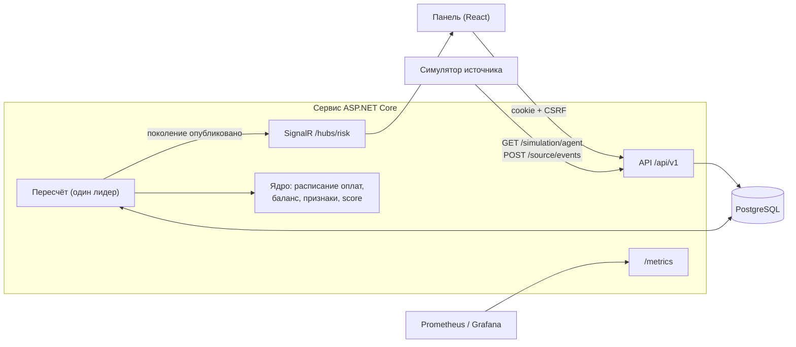

# Архитектура

Модульный монолит: один сервис на ASP.NET Core (.NET 10) и PostgreSQL 17. Панель — React 19 + TypeScript. Расчёт риска вынесен в
чистое ядро без зависимостей от базы и HTTP, поэтому его легко тестировать и расширять.

## Содержание

- [Схема](#схема)
- [Проекты](#проекты)
- [Данные](#данные)
- [Пересчёт и согласованность](#пересчёт-и-согласованность)
- [Живое обновление](#живое-обновление)
- [Симуляция](#симуляция)
- [Безопасность](#безопасность)
- [Метрики](#метрики)
- [ML: основной балл или тень](#ml-основной-балл-или-тень)
- [Развёртывание](#развёртывание)
- [Расширение](#расширение)

## Схема

## Проекты

| Проект | Назначение |
| --- | --- |
| `src/Aeza.Risk.Core` | Ядро: расписание оплат, распределение баланса, признаки, score, деньги, индикаторы оттока, правила применения событий. Время приходит параметром |
| `src/Aeza.Risk.Feature` | Эндпоинты по вертикальным срезам: `Auth`, `Customers`, `Analytics`, `Model`, `Source`, `Export`, `Jobs`, `Ml`, `Simulation` |
| `src/Aeza.Risk.Infrastructure` | EF Core и миграции, репозитории, приём событий, фоновый пересчёт, SignalR, метрики, проверки здоровья |
| `src/Aeza.Risk.Web` | Точка входа: аутентификация, CORS, Swagger UI, раздача панели |
| `src/Aeza.Risk.Migrator` | Миграции и роль приложения в БД отдельным шагом, смена пароля |
| `src/Aeza.Risk.SharedKernel` | Базовые классы эндпоинтов, настройка OpenAPI, JSON |
| `web/` | Панель: Обзор, Клиенты, Карточка клиента, Модель, Источник, Симуляция |
| `tools/Aeza.Risk.SourceSimulator` | Симулятор системы-источника: единственный поставщик данных в режиме событий (данные помечены как события симулятора) |
| `tools/Aeza.Risk.Ml` | Офлайн-обучение теневой модели |
| `test/` | Unit, интеграционные на PostgreSQL (Testcontainers), тесты симулятора и ML |

## Данные

- **База** (`source_snapshots`, `src_*`) — неизменяемый снимок. В режиме событий это пустая база: все записи приходят событиями.
  Без режима событий — тестовые данные организаторов, загруженные целиком.
- **Журнал событий** (`source_events`, `source_domain_events`) — всё, что прислал источник, с исходом: применено, без изменений, устарело, повтор.
- **Текущее состояние** (`cur_accounts`, `cur_services`, `cur_transactions`) — тестовые данные плюс события; обновляется в той же
  транзакции, что и журнал. События без версии применяются по правилам монотонности: срок и сумма пополнений не убывают,
  удалённая услуга не воскресает, проведённая транзакция не откатывается.
- **Активность клиентов** (`customer_activity_daily`) — дневные итоги поведения из событий: входы, нагрузка, платежи, обращения.
- **Исходы сроков** (`expiry_outcomes`) — продлён срок или нет; «не продлено» фиксируется только при свежем источнике.
- **Настройки модели** (`model_revisions`) — неизменяемые ревизии весов и порогов; переживают перезапуск.
- **Результаты** (`generations`, `customer_results`) — опубликованные расчёты.
- **Симуляция** (`simulation_state`) — настройки симуляции, текущий snapshot системы (ревизия, момент создания, параметры), последний отчёт
  симулятора.
- **Служебное**: задания пересчёта, пользователи и сессии, журнал аудита, импорты истории, ML-модели.

## Пересчёт и согласованность

1. Любое изменение — загрузка данных, событие, новая ревизия весов — сохраняется вместе с заданием пересчёта и сразу возвращает `202`.
2. Пересчёт выполняет один экземпляр-лидер (advisory lock PostgreSQL). Он объединяет накопившиеся задания и читает все входы
   в одной транзакции.
3. Ядро считает результат, и он сохраняется как **поколение** — неизменяемый набор результатов с версиями всех входов: тестовые
   данные, позиция журнала, ревизия весов, активность, модель ML, момент оценки.
4. Поколение публикуется атомарно. Задание со старыми входами не может перезаписать более новое поколение.
5. После перезапуска незавершённые задания возвращаются в очередь.

Панель, API и `/metrics` читают одно и то же поколение, его номер есть в каждом ответе. Поэтому цифры везде одинаковые.
В режиме часов «live» результат пересчитывается и с течением времени, раз в 5 минут, даже без новых данных: сроки приближаются,
срочность растёт.

## Живое обновление

После публикации поколения сервис шлёт событие через SignalR (`/hubs/risk`). Панель перечитывает данные без перезагрузки страницы.
При нескольких экземплярах сервиса события расходятся между ними через `LISTEN/NOTIFY` PostgreSQL. Если соединение пропало,
панель переходит на опрос раз в 15 секунд и сама переподключается.

## Симуляция

Сервис работает только на событиях (`Simulation:EventsOnly`, по умолчанию включено в Compose и Helm). При пустой БД создаётся
пустая база вместо загрузки тестовых данных. Данные присылает симулятор — отдельный процесс из того же образа.

- **Кто кого вызывает.** Симулятор опрашивает сервис: `GET /api/v1/simulation/agent` (настройки, текущий snapshot системы и события
  из конструктора), `POST /api/v1/simulation/agent/status` (свой отчёт) и `POST /api/v1/simulation/agent/commands` (итоги событий
  из конструктора). События он шлёт обычным коннектором `POST /api/v1/source/events`. Все маршруты — с `INGEST_TOKEN`; токен не
  открывает ни клиентов, ни настройки. Сервис к симулятору не обращается.
- **Snapshot системы.** Начальный snapshot системы — записи аккаунтов, услуг и транзакций событиями: тестовые данные организаторов с дополнительными
  клиентами или сгенерированные клиенты с историей. Snapshot системы детерминирован моментом создания и параметрами, поэтому после перезапуска
  симулятор продолжает тот же snapshot системы, а его состояние и очередь отправки лежат на томе.
- **Пересоздание.** `POST /api/v1/simulation/reset` под той же блокировкой, что и приём событий, очищает данные источника,
  журнал и результаты, создаёт пустую базу и увеличивает ревизию snapshot системы. Симулятор помечает каждый пакет заголовком
  `X-Simulation-World`; пакет с прежней ревизией сервис отклоняет `409 simulation_world_changed`, так что опоздавшие события
  старого snapshot системы не смешиваются с новым. Пересчёт, начатый до очистки, не публикуется: его база уже не текущая.
- **Настройки** хранятся в БД и переживают перезапуск. Симуляция работает постоянно (паузы нет); такт и сбои доставки применяются
  при следующем опросе, параметры snapshot системы — после пересоздания.
- **Конструктор событий.** Администратор собирает событие в панели (`POST /api/v1/simulation/events`): сервис проверяет поля, клиента
  и владельца услуги по текущим данным и кладёт событие в очередь `simulation_commands` с ревизией snapshot системы. Симулятор
  забирает ожидающие события вместе с указаниями, применяет каждое один раз тем же действием, что и поведение клиента (номер события
  аккаунта, состояние snapshot системы и поток остаются согласованными), пишет результат в outbox и сообщает итог: `applied` с
  `eventId` или `rejected` с причиной. Итоги хранятся у симулятора, пока сервис их не примет, поэтому перезапуск не теряет и не
  повторяет событие. Пересоздание snapshot системы отклоняет ожидающие события.

`PUT /api/v1/source/snapshot` остаётся рабочим: снимок заменяет базу, и поток событий продолжает применяться поверх него.

## Безопасность

- Вход по логину и паролю: HttpOnly cookie-сессия, сессии хранятся в БД и отзываются сразу; CSRF-токен на всех изменяющих запросах;
  ограничение попыток входа.
- Роли: `admin` меняет веса и данные, `analyst` только читает.
- Источник событий авторизуется токеном коннектора и не получает доступа к клиентам и настройкам.
- Приложение работает в БД под ролью только с правами на данные; миграции — отдельной ролью.
- `/metrics` отдаётся без входа сборщику метрик и содержит только агрегаты — без email и идентификаторов клиентов.

## Метрики

`/metrics` в формате Prometheus (OpenTelemetry): клиенты по уровням риска, выручка под риском, плановые продления, непокрытая часть,
типы оттока, исходы сроков, свежесть источника и номер поколения. Для Grafana есть готовый дашборд (`deploy/grafana`).

## ML: основной балл или тень

Модель обучается офлайн (`tools/Aeza.Risk.Ml`, ML.NET) на журнале событий: признаки на момент решения, метка — продлён срок или нет.
Результат — пакет с ONNX-файлом. Пакет по умолчанию входит в образ (`Ml:DefaultBundle`) и загружается при первом запуске, если
моделей в БД ещё нет; администратор может заменить его в панели. Сервис считает вероятность через ONNX Runtime.

Режим основного балла (`app_state.scoring_primary`: `ml` по умолчанию | `rules`). В режиме ML ядро получает вероятности услуг и
считает от них score, уровни, причины и деньги тем же кодом, что и для правил; правила всё равно считаются рядом для сравнения.
В режиме правил модель работает в тени и score не меняет. Если модели нет или она не выполнилась, поколение считается правилами с
пометкой `scoring.fallback`. Смена режима входит во входы поколения, поэтому пересчёт публикуется атомарно, как при смене весов.
Подробнее — [Как считается score](scoring.md#основной-балл-правила-или-ml).

## Развёртывание

- **Docker Compose** — `docker-compose.yml`: база, миграции, сервис, симулятор, по профилям — nginx с TLS и Prometheus с Grafana.
  `docker-compose.local.yaml` — стенд для разработки: сервис и панель отдельно, симулятор, мониторинг.
- **Kubernetes (k3s)** — Helm-чарты в `deploy/helm`: сервис и панель (по 2 реплики), симулятор (1 реплика, том состояния),
  PostgreSQL, мониторинг.
- **CI** — `.gitlab-ci.yml`: сборка образов, выкатка в k3s вручную, откат на предыдущую версию.

## Расширение

- **Новый признак** — один класс в ядре и одна строка в каталоге признаков. Редактор весов, причины, деньги и API строятся по
  каталогу и подхватят его сами ([пример](../README.md#как-добавить-признак)).
- **Новый источник данных** — новый токен коннектора: формат событий общий для всех источников.
- **Новый тип события** — разбор в ядре; неизвестные типы сохраняются в журнале и учитываются в качестве потока, а не отбрасываются.
