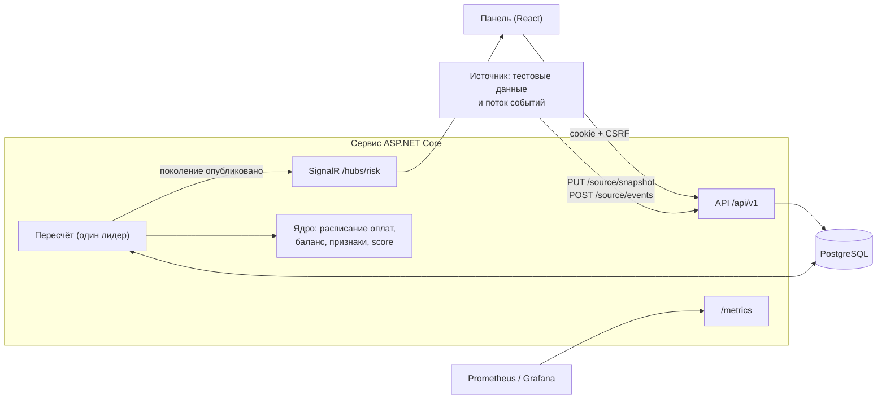

# Архитектура

Модульный монолит: один сервис на ASP.NET Core (.NET 10) и PostgreSQL 17. Панель — React 19 + TypeScript. Расчёт риска вынесен в
чистое ядро без зависимостей от базы и HTTP, поэтому его легко тестировать и расширять.

## Содержание

- [Схема](#схема)
- [Проекты](#проекты)
- [Данные](#данные)
- [Пересчёт и согласованность](#пересчёт-и-согласованность)
- [Живое обновление](#живое-обновление)
- [Безопасность](#безопасность)
- [Метрики](#метрики)
- [ML в тени](#ml-в-тени)
- [Развёртывание](#развёртывание)
- [Расширение](#расширение)

## Схема

## Проекты

| Проект | Назначение |
| --- | --- |
| `src/Aeza.Risk.Core` | Ядро: расписание оплат, распределение баланса, признаки, score, деньги, индикаторы оттока, правила применения событий. Время приходит параметром |
| `src/Aeza.Risk.Feature` | Эндпоинты по вертикальным срезам: `Auth`, `Customers`, `Analytics`, `Model`, `Source`, `Export`, `Jobs`, `Ml` |
| `src/Aeza.Risk.Infrastructure` | EF Core и миграции, репозитории, приём событий, фоновый пересчёт, SignalR, метрики, проверки здоровья |
| `src/Aeza.Risk.Web` | Точка входа: аутентификация, CORS, Swagger UI, раздача панели |
| `src/Aeza.Risk.Migrator` | Миграции и роль приложения в БД отдельным шагом, смена пароля |
| `src/Aeza.Risk.SharedKernel` | Базовые классы эндпоинтов, настройка OpenAPI, JSON |
| `web/` | Панель: Обзор, Клиенты, Карточка клиента, Модель, Источник |
| `tools/Aeza.Risk.SourceSimulator` | Симулятор системы-источника для демонстрации потока событий (данные помечены как синтетика) |
| `tools/Aeza.Risk.Ml` | Офлайн-обучение теневой модели |
| `test/` | Unit, интеграционные на PostgreSQL (Testcontainers), тесты симулятора и ML |

## Данные

- **Тестовые данные** (`source_snapshots`, `src_*`) — загрузка организаторов целиком, неизменяемая.
- **Журнал событий** (`source_events`, `source_domain_events`) — всё, что прислал источник, с исходом: применено, без изменений, устарело, повтор.
- **Текущее состояние** (`cur_accounts`, `cur_services`, `cur_transactions`) — тестовые данные плюс события; обновляется в той же
  транзакции, что и журнал. События без версии применяются по правилам монотонности: срок и сумма пополнений не убывают,
  удалённая услуга не воскресает, проведённая транзакция не откатывается.
- **Активность клиентов** (`customer_activity_daily`) — дневные итоги поведения из событий: входы, нагрузка, платежи, обращения.
- **Исходы сроков** (`expiry_outcomes`) — продлён срок или нет; «не продлено» фиксируется только при свежем источнике.
- **Настройки модели** (`model_revisions`) — неизменяемые ревизии весов и порогов; переживают перезапуск.
- **Результаты** (`generations`, `customer_results`) — опубликованные расчёты.
- **Служебное**: задания пересчёта, пользователи и сессии, журнал аудита, импорты истории, ML-модели.

## Пересчёт и согласованность

1. Любое изменение — загрузка данных, событие, новая ревизия весов — сохраняется вместе с заданием пересчёта и сразу возвращает `202`.
2. Пересчёт выполняет один экземпляр-лидер (advisory lock PostgreSQL). Он объединяет накопившиеся задания и читает все входы
   в одной транзакции.
3. Ядро считает результат, и он сохраняется как **поколение** — неизменяемый набор результатов с версиями всех входов: тестовые
   данные, позиция журнала, ревизия весов, активность, модель ML, момент оценки.
4. Поколение публикуется атомарно. Задание со старыми входами не может перезаписать более новое поколение.
5. После перезапуска незавершённые задания возвращаются в очередь.

Панель, API и `/metrics` читают одно и то же поколение, его номер есть в каждом ответе. Поэтому цифры везде одинаковые.
В режиме часов «live» результат пересчитывается и с течением времени, раз в 5 минут, даже без новых данных: сроки приближаются,
срочность растёт.

## Живое обновление

После публикации поколения сервис шлёт событие через SignalR (`/hubs/risk`). Панель перечитывает данные без перезагрузки страницы.
При нескольких экземплярах сервиса события расходятся между ними через `LISTEN/NOTIFY` PostgreSQL. Если соединение пропало,
панель переходит на опрос раз в 15 секунд и сама переподключается.

## Безопасность

- Вход по логину и паролю: HttpOnly cookie-сессия, сессии хранятся в БД и отзываются сразу; CSRF-токен на всех изменяющих запросах;
  ограничение попыток входа.
- Роли: `admin` меняет веса и данные, `analyst` только читает.
- Источник событий авторизуется токеном коннектора и не получает доступа к клиентам и настройкам.
- Приложение работает в БД под ролью только с правами на данные; миграции — отдельной ролью.
- `/metrics` отдаётся без входа сборщику метрик и содержит только агрегаты — без email и идентификаторов клиентов.

## Метрики

`/metrics` в формате Prometheus (OpenTelemetry): клиенты по уровням риска, выручка под риском, плановые продления, непокрытая часть,
типы оттока, исходы сроков, свежесть источника и номер поколения. Для Grafana есть готовый дашборд (`deploy/grafana`).

## ML в тени

Модель обучается офлайн (`tools/Aeza.Risk.Ml`, ML.NET) на журнале событий: признаки на момент решения, метка — продлён срок или нет.
Результат — ONNX-файл, который администратор загружает в панели. Сервис считает вероятность через ONNX Runtime рядом со score,
не меняя score, уровни и деньги. Если модель не загрузилась или не уложилась в таймаут, расчёт идёт только по правилам.
Подробнее — [Как считается score](scoring.md#теневая-ml-модель).

## Развёртывание

- **Docker Compose** — `docker-compose.yml`: база, миграции, сервис, по профилям — nginx с TLS и Prometheus с Grafana.
  `docker-compose.local.yaml` — стенд для разработки: сервис и панель отдельно, мониторинг, симулятор источника.
- **Kubernetes (k3s)** — Helm-чарты в `deploy/helm`: сервис и панель (по 2 реплики), PostgreSQL, мониторинг.
- **CI** — `.gitlab-ci.yml`: сборка образов, выкатка в k3s вручную, откат на предыдущую версию.

## Расширение

- **Новый признак** — один класс в ядре и одна строка в каталоге признаков. Редактор весов, причины, деньги и API строятся по
  каталогу и подхватят его сами ([пример](../README.md#как-добавить-признак)).
- **Новый источник данных** — новый токен коннектора: формат событий общий для всех источников.
- **Новый тип события** — разбор в ядре; неизвестные типы сохраняются в журнале и учитываются в качестве потока, а не отбрасываются.
